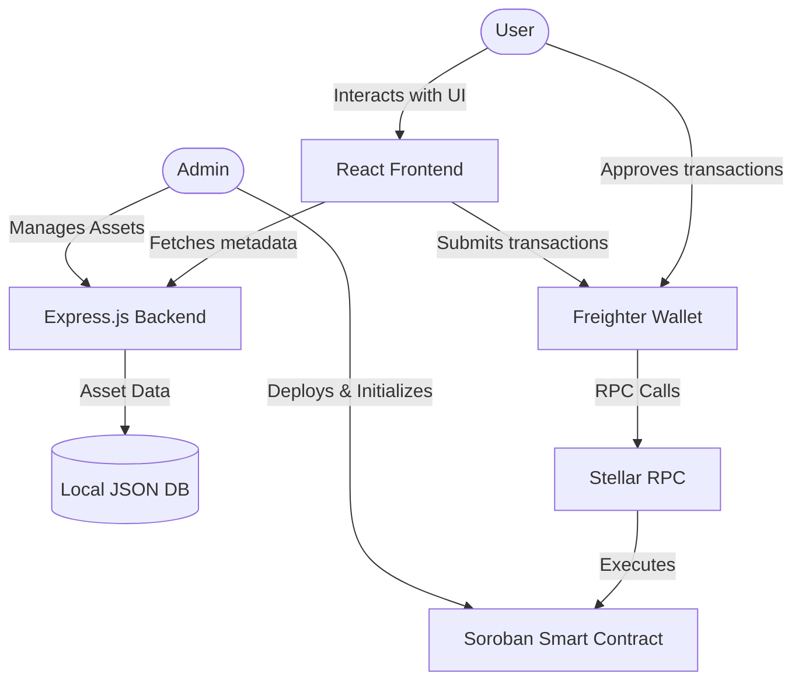
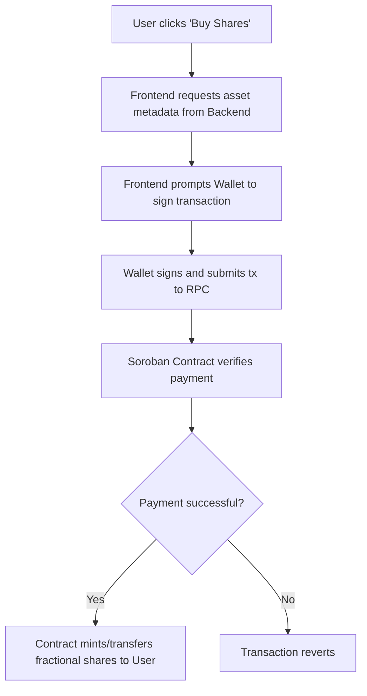
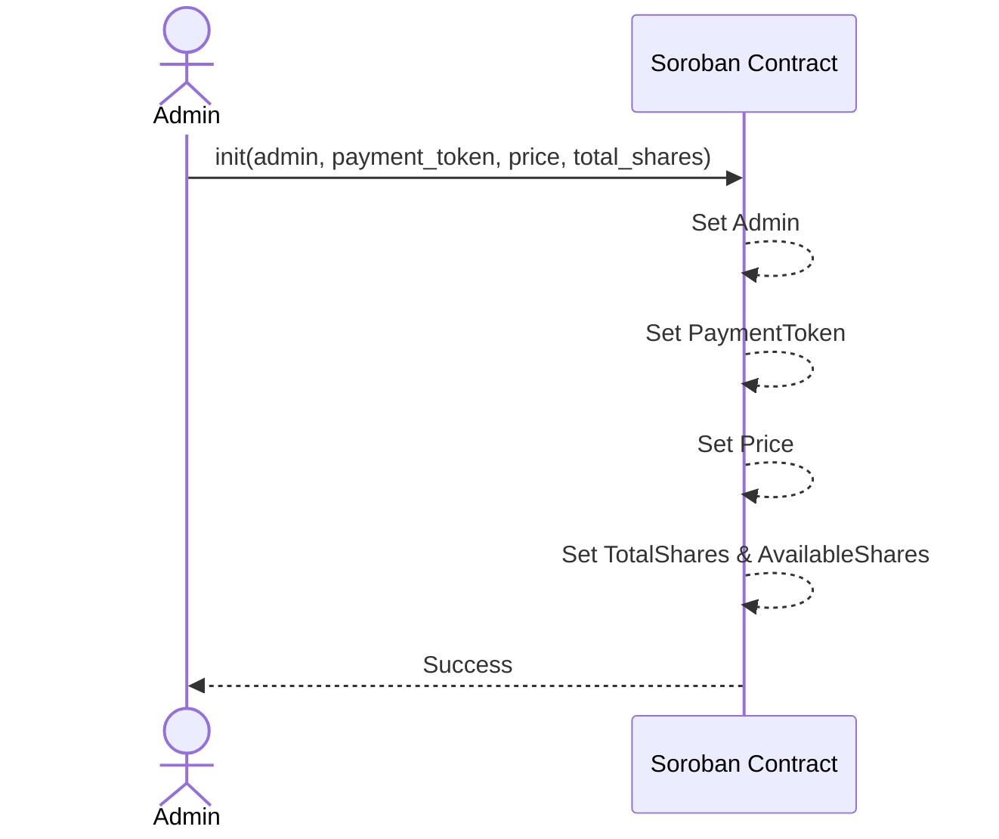
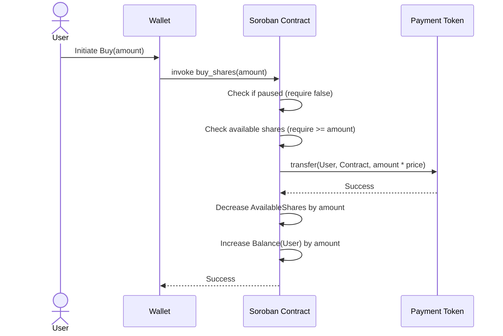

# Architecture Overview

The Tokenized Fractional Real-World Assets (RWA) Marketplace is a decentralized application built on the Stellar Network using Soroban Smart Contracts.

## System Architecture

The system consists of three main components:
1. **Frontend**: React + Vite application that interacts with the user and the Freighter wallet.
2. **Backend**: Express.js server providing off-chain metadata for the tokenized assets.
3. **Smart Contract**: Soroban contract (Rust) on the Stellar Network handling the core logic, ownership, and payments.



## Data Flow Diagrams

### Buy Shares Flow



## Smart Contract Storage Layout

The Soroban smart contract uses the following keys to store data on the ledger:

- `Admin`: The administrator's address with privileges to initialize and pause.
- `PaymentToken`: The address of the token (e.g., USDC) accepted for purchasing shares.
- `Price`: The price per fractional share.
- `TotalShares`: The maximum number of shares available for the asset.
- `AvailableShares`: The current number of shares remaining for purchase.
- `IsPaused`: A boolean indicating if the marketplace is paused.
- `Balance(Address)`: Maps a user's address to their current share balance.

## Sequence Diagrams

### Initialize Marketplace (Admin)



### Purchase Shares (User)



## API Endpoints

### Backend API (REST)

| Method | Endpoint | Auth | Description |
|---|---|---|---|
| `GET` | `/health` | No | Health check for the backend service |
| `GET` | `/api/rwa` | No | List all real-world assets available |
| `GET` | `/api/rwa/:contractId` | No | Get metadata for a specific asset |
| `POST` | `/api/rwa` | `x-api-key` | Create or update asset metadata |
| `DELETE` | `/api/rwa/:contractId` | `x-api-key` | Delete asset metadata |

### Smart Contract Functions

The **Affected by Pause** column states whether `pause()` (i.e. `IsPaused == true`)
blocks the function. Read-only `get_*` view functions are **never** blocked by a
pause, so the frontend can keep rendering balances, prices and metadata during
an incident (see [Pause semantics](#pause-semantics)).

| Function | Access | Affected by Pause | Description |
|---|---|---|---|
| `init` | Admin | n/a (pre-init) | Initializes the marketplace configuration. |
| `buy_shares` | Any | Yes | Purchases a specified amount of shares using an accepted payment token. |
| `buy_vested_shares` | Any | Yes | Purchases shares subject to a vesting schedule. |
| `buy_from_order` | Any | Yes | Fills an open sell order. |
| `place_sell_order` | Any | Yes | Escrows shares into a new sell order. |
| `cancel_sell_order` | Any | Yes | Cancels an open sell order and returns the escrowed shares. |
| `buyback_shares` | Any | Yes | Sells shares back to the contract at the current price. |
| `transfer_shares` | Any | Yes | Transfers shares between two whitelisted holders. |
| `transfer_shares_from` | Any | Yes | Transfers shares using an allowance. |
| `batch_transfer` | Any | Yes | Transfers shares to several recipients. |
| `get_shares` | Any | No | Returns the number of shares owned by a user. |
| `get_available_shares` | Any | No | Returns the remaining shares available for purchase. |
| `get_total_shares` | Any | No | Returns the total supply of shares for the asset. |
| `get_price` | Any | No | Returns the price per share. |
| `get_holders` | Any | No | Returns every address with a registered share position (cap table). |
| `get_admin` | Any | No | Returns the address that currently administers the contract. |
| `get_payment_token` | Any | No | Returns the default payment token. |
| `get_accepted_tokens` | Any | No | Returns the list of accepted payment tokens. |
| `get_pending_distribution` | Any | No | Returns the income a holder can currently claim. |
| `get_unclaimed_distribution` | Any | No | Returns the total deposited-but-unclaimed income. |
| `get_contract_metadata` | Any | No | Returns the SIP-4 compliant contract metadata. |
| `is_paused` | Any | No | Returns whether the marketplace is currently paused. |
| `pause` | Admin | n/a | Pauses the marketplace to prevent new state-changing operations. |
| `unpause` | Admin | n/a | Unpauses the marketplace. |
| `add_payment_token` | Admin | No | Adds an accepted payment token (multi-asset acceptance). |
| `remove_payment_token` | Admin | No | Removes an accepted payment token (the default cannot be removed). |
| `update_payment_token` | Admin | **Only while paused** | Migrates the default payment token; requires zero outstanding unclaimed funds in the old token. |
| `deposit_distribution` | Admin | No | Deposits asset income for pro-rata distribution to current holders. |
| `claim_distribution` | Holder | No | Claims the caller's accrued income distribution. |
| `distribute_dividends` | Admin | No | Legacy push-based pro-rata dividend distribution. |
| `claim_dividends` | Holder | No | Claims accrued dividends accrued by the policy-based flow. |
| `update_price` | Admin | Only while paused | Corrects the price per share. Requires `pause`; rejects non-positive prices. |
| `increase_total_shares` | Admin | Only while paused | Adds supply for a follow-on offering of the same underlying asset. |
| `emergency_withdraw` | Admin | No | Withdraws accumulated payment tokens from the contract to the admin. |

### Pause semantics

`pause()` sets `IsPaused`, which **only** blocks state-changing entry points
(see the table above) — currently `buy_shares`, `buy_vested_shares`,
`buy_from_order`, `place_sell_order`, `buyback_shares` and the transfer
entry points. It never blocks read-only view functions: `get_shares`,
`get_available_shares`, `get_total_shares`, `get_price`, `get_holders`,
`get_accepted_tokens`, `get_payment_token`, `get_contract_metadata` and the
other `get_*` functions continue to return their normal values while paused.
This is intentional: during an incident response the frontend must still be
able to display the asset's state to users.

A separate, per-function pause flag set (`pause_function` / `unpause_function`)
can block narrower groups of mutations (purchases, transfers, sell orders,
dividends, buybacks) without pausing the whole marketplace. Those flags also do
not affect read-only functions.

### Cap table enumeration

The contract keeps an on-chain holder registry (`DataKey::Holders`) that is
appended to by `register_holder` on the first purchase or first inbound
transfer of an address. `get_holders()` returns that registry, so issuers can
enumerate all addresses holding a position without relying on off-chain event
indexing. The registry is pruned of zero-balance holders during dividend
distribution, and `get_shares(addr)` remains available as an O(1) point lookup
for a single known address.

### Income / dividend distribution model

Asset income is distributed with a **pull-based accumulator** (Issue #765),
which keeps both deposit and claim cost O(1) and never iterates over holders:

- `deposit_distribution(amount)` (admin only) raises a global accumulator
  `acc += amount * 1e9 / issued_shares` and pulls the deposit from the admin
  only if the contract does not already custody the funds.
- `claim_distribution(holder)` (holder only) settles the caller's entitlement
  and transfers it.
- `get_pending_distribution(holder)` reports the claimable amount without
  mutating state.

Each holder stores an accumulator snapshot and a pending balance. The snapshot
is refreshed (settled) **before every share-balance change** — buys, transfers,
order escrow/release, vesting claims, buybacks and bridge lock/unlock — so a
holder only accrues on the balance they actually held while the accumulator
moved. This makes claims correct even when shares are transferred after a
deposit. Because the per-share entitlement is floored, a sub-unit rounding
residue can remain in the contract; it is not attributable to any holder and
can be swept with `emergency_withdraw`.

A legacy push-based distribution also exists (`distribute_dividends`,
`process_scheduled_dividend`, `claim_dividends`) using `DividendPolicy` and
`DividendPosition` for withholding, reinvestment and scheduled payouts. New
integrations should prefer `deposit_distribution` / `claim_distribution`.

## SIP‑4 / SEP‑46 Contract Metadata

The contract implements the [SIP‑4](https://github.com/stellar/stellar-protocol/blob/master/core/sip-0004.md) / [SEP‑46](https://github.com/stellar/stellar-protocol/blob/master/ecosystem/sep-0046.md) metadata standard, providing both compile-time and runtime metadata:

- **Compile-time metadata** — embedded in the Wasm `contractmetav0` custom section via the `contractmeta!()` macro. Off-chain tools (explorers, wallets, indexers) read these entries without executing the contract.
- **Runtime metadata** — stored in contract instance storage and returned by `get_contract_metadata()`. Accessible on-chain by other contracts.

### Wasm Custom Section Entries

| Key | Value |
|-----|-------|
| `name` | `RWA Marketplace` |
| `version` | `0.2.0` |
| `description` | `Tokenized Fractional RWA Marketplace` |
| `sep` | `41` |

### Data Types

```rust
#[contracttype]
pub struct ContractMetadata {
    pub name: soroban_sdk::String,
    pub version: soroban_sdk::String,
    pub description: soroban_sdk::String,
}
```
